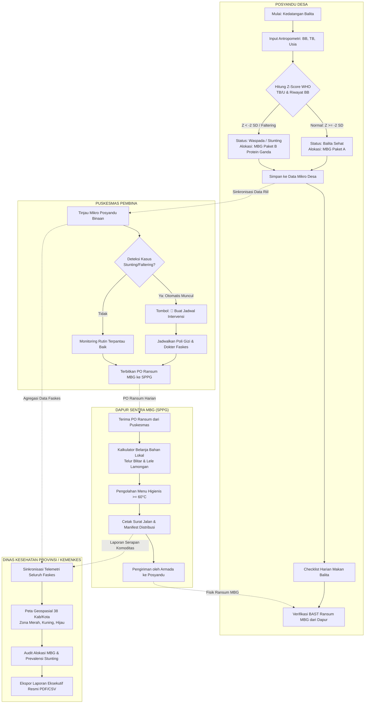
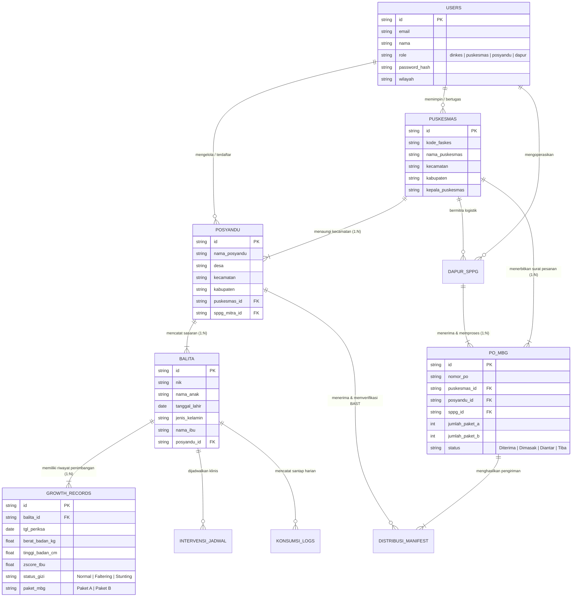

# PROPOSAL LOMBA PROGRAMMING
## Information System Competition Festival (ISCOMFEST) 2026

---

<p align="center">
  <br />
  <strong>NUTRITRACK: PLATFORM PRESISI INTERVENSI STUNTING & PEMANTAUAN PROGRAM MAKAN BERGIZI GRATIS (MBG) TERINTEGRASI BERBASIS BIO-NUTRISI KOMODITAS LOKAL</strong><br />
  <em>Sistem Informasi Geospasial, Smart KMS Digital, dan Decision Support System Rantai Pasok Pangan Terdesentralisasi dari Posyandu hingga Kementerian Kesehatan RI</em>
  <br /><br />
</p>

<p align="center">
  
  <br /><br />
</p>

<p align="center">
  <strong>Diusulkan oleh:</strong><br />
  <strong>Ketua Tim:</strong> Jefri & Tim Pengembang NutriTrack<br />
  <strong>Anggota 1:</strong> Tim Kolaborasi Rekayasa Perangkat Lunak<br />
  <strong>Anggota 2:</strong> Tim Riset Nutrisi & Data Kesehatan Masyarakat<br />
  <strong>Asal Perguruan Tinggi / Sekolah:</strong> Institut / Universitas Kolaborator Jawa Timur & Nasional<br />
  <strong>Kota:</strong> Surabaya / Bangkalan<br />
  <strong>Tahun:</strong> 2026
</p>

<div style="page-break-after: always;"></div>

---

## DAFTAR ISI

- **Halaman Judul / Sampul** ........................................................................ i
- **Daftar Isi** ................................................................................................. ii
- **1. Latar Belakang dan Permasalahan/Ide** ............................................... 1
  - 1.1 Situasi dan Urgensi Stunting di Indonesia ............................................ 1
  - 1.2 Program Makan Bergizi Gratis (MBG) dan Tantangan Presisi ................. 2
  - 1.3 Permasalahan Fragmentasi Data Faskes ................................................ 3
  - 1.4 Gagasan Solutif: NutriTrack ................................................................... 3
- **2. Tujuan dan Manfaat Website** ........................................................... 4
  - 2.1 Tujuan Pengembangan Sistem ............................................................. 4
  - 2.2 Manfaat bagi Multi-Stakeholder ........................................................... 4
- **3. Deskripsi Website dan Fitur Utama** ................................................. 5
  - 3.1 Gambaran Umum Website .................................................................... 5
  - 3.2 Fitur Utama Berdasarkan Peran Pengguna (Role-Based) ........................ 5
- **4. Teknologi yang Digunakan** ............................................................... 7
  - 4.1 Frontend Tech Stack ............................................................................. 7
  - 4.2 Backend & Decision Engine Stack ......................................................... 7
  - 4.3 Database, Keamanan, & Standar Medis ................................................ 7
- **5. Rancangan dan Alur Sistem** ............................................................ 8
  - 5.1 Arsitektur Sistem Terintegrasi Multi-Tier ................................................. 8
  - 5.2 Alur Kerja Operasional Lintas Peran (Flowchart) .................................... 8
  - 5.3 Pemodelan Data & Entitas Relasional (ERD) .......................................... 9
- **6. Tangkapan Layar Tampilan Website** ................................................ 9
  - 6.1 Halaman Autentikasi Mandiri & Pendaftaran Posyandu ......................... 9
  - 6.2 Dasbor Operasional 4 Peran Kunci ........................................................ 9
  - 6.3 Modul Pencetakan Dokumen Laporan Kedinasan ................................. 10
- **7. Penutup dan Rencana Pengembangan** ............................................ 10
  - 7.1 Kesimpulan ........................................................................................... 10
  - 7.2 Rencana Pengembangan Lanjutan Skala Nasional ................................. 10
- **Daftar Pustaka** ...................................................................................... 11
- **LAMPIRAN** ............................................................................................ 12
  - Lampiran 1: Diagram Alir Sistem (Flowchart Multi-Role) ........................... 12
  - Lampiran 2: Entity Relationship Diagram (ERD) Sistem NutriTrack ............. 13
  - Lampiran 3: Diagram Arsitektur Data Pipeline Terdesentralisasi ................... 14
  - Lampiran 4: Galeri Tangkapan Layar Antarmuka Website ............................ 15

<div style="page-break-after: always;"></div>

---

## 1. Latar Belakang dan Permasalahan/Ide

### 1.1 Situasi dan Urgensi Stunting di Indonesia
Stunting (tengkes) merupakan manifestasi kegagalan pertumbuhan linier kronis pada balita akibat malnutrisi berkepanjangan dan infeksi berulang selama 1.000 Hari Pertama Kehidupan (HPK). Berdasarkan laporan Survei Kesehatan Indonesia (SKI) dan Survei Status Gizi Indonesia (SSGI), prevalensi stunting nasional masih berada pada angka **21,5%**, dengan disparitas regional yang sangat curam di berbagai kantong wilayah seperti Madura, Nusa Tenggara Timur, Nusa Tenggara Barat, hingga Papua yang bahkan melampaui **30%** [1], [2]. Angka ini masih jauh dari ambang batas aman yang ditetapkan Organisasi Kesehatan Dunia (WHO) sebesar **20%**, serta meleset dari target ambisius Rencana Pembangunan Jangka Menengah Nasional (RPJMN) sebesar **14%** [3], [4].

Stunting bukan sekadar masalah tinggi badan fisik yang pendek (*short stature*), melainkan ancaman irreversible terhadap neuro-kognitif, penurunan rata-rata Intelligence Quotient (IQ) hingga 10–15 poin, tingginya risiko morbiditas sindrom metabolik degeneratif saat dewasa, serta potensi kehilangan Produk Domestik Bruto (PDB) negara hingga 2–3% per tahun akibat hilangnya produktivitas sumber daya manusia [5], [6].

### 1.2 Program Makan Bergizi Gratis (MBG) dan Tantangan Presisi
Sebagai langkah akselerasi penanganan malnutrisi, Pemerintah Republik Indonesia menggulirkan program strategis nasional **Makan Bergizi Gratis (MBG)** melalui Badan Gizi Nasional (BGN) yang disalurkan melalui Satuan Pelayanan Pangan Bergizi (SPPG) [7]. Kendati demikian, pelaksanaan di lapangan menghadapi tantangan mendasar: **ketiadaan stratifikasi presisi klinis**. Makanan bergizi yang dibagikan cenderung diseragamkan untuk seluruh anak tanpa membedakan kondisi gizi aktual. 

Padahal, ilmu nutrisi klinis menegaskan bahwa balita dengan status **Gizi Normal (Kategori Hijau)** hanya memerlukan ransum pemeliharaan kalori reguler (**Paket A**). Sebaliknya, balita yang mengalami ***Growth Faltering* (Kategori Kuning/Waspada)** dan balita **Stunting Garis Merah (Kategori Merah)** membutuhkan intervensi kuratif tinggi protein hewani berkualitas (*high biological value*) ganda (**Paket B / Paket C**) guna menstimulasi sekresi hormon *Insulin-like Growth Factor 1* (IGF-1) pada lempeng pertumbuhan tulang kondrosit [8], [9]. Tanpa pemisahan data yang presisi, anggaran negara ratusan triliun rupiah berisiko mengalami inefisiensi, kebocoran distribusi, dan gagal menurunkan kurva stunting secara drastis [10].

### 1.3 Permasalahan Fragmentasi Data Faskes
Akar dari kegagalan intervensi presisi adalah fragmentasi data (*data silos*) antar lini pelayanan:
1. **Posyandu Desa**: Kader posyandu masih mengandalkan pencatatan kertas pada Buku Kesehatan Ibu dan Anak (KIA) atau aplikasi terisolasi yang lambat disinkronkan, sehingga keterlambatan deteksi *growth faltering* mencapai hitungan bulan [11].
2. **Puskesmas Pembina**: Dokter spesialis anak dan nutrisionis puskesmas tidak memiliki akses telemetri mikro harian terhadap kondisi riil anak di desa binaan mereka, menyulitkan penerbitan rujukan klinis dan resep intervensi [12].
3. **Sentra Dapur MBG (SPPG)**: Dapur memasak berdasarkan estimasi kasar tanpa mengetahui berapa porsi gizi reguler dan berapa porsi terapi protein hewani yang wajib didistribusikan ke masing-masing titik desa [7].
4. **Dinas Kesehatan / Kemenkes**: Pembuat kebijakan hanya menerima laporan agregat tahunan yang bersifat retrospektif dan terlambat dievaluasi [13].

### 1.4 Gagasan Solutif: NutriTrack
Berdasarkan analisis tersebut, dikembangkan **NutriTrack**: platform perangkat lunak presisi berbasis web yang mengintegrasikan seluruh aktor penanganan stunting dan MBG dalam satu rantai nilai digital tertutup (*closed-loop health data pipeline*). NutriTrack menghubungkan input antropometri mikro di posyandu desa, verifikasi klinis puskesmas, operasional logistik dapur SPPG berbasis komoditas lokal, hingga pengawasan geospasial real-time tingkat dinas kesehatan provinsi dan kementerian.

---

## 2. Tujuan dan Manfaat Website

### 2.1 Tujuan Pengembangan Sistem
1. **Membangun Sistem Kartu Menuju Sehat (KMS) Digital Pintar**: Menyediakan engine perhitungan Z-Score otomatis berstandar WHO Anthro 2006 dan Permenkes RI No. 2/2020 dengan peringatan dini *growth faltering* [3], [14].
2. **Mewujudkan Presisi Alokasi Menu MBG**: Mengotomatisasi konversi status antropometri anak menjadi pesanan porsi menu MBG terstratifikasi (**Paket A Gizi Reguler** vs **Paket B Intervensi Protein Ganda**).
3. **Mendorong Kedaulatan Pangan & Komoditas Lokal**: Mengintegrasikan kalkulator serapan bahan pangan lokal (seperti Telur Ayam Blitar, Ikan Lele Lamongan, Kelor Batu pada pilot Jawa Timur, yang dapat diadopsi ke seluruh kepulauan Indonesia) sehingga 100% perputaran stimulus ekonomi tetap berada di level peternak rakyat dan petani domestik [15].
4. **Menerapkan Interoperabilitas & Otomasi Pelaporan Kedinasan**: Menyediakan fitur legalitas dokumen berupa cetak Berita Acara Serah Terima (BAST), Surat Pesanan (PO), dan Laporan Eksekutif berstandar regulasi pemerintah dengan ekspor PDF dan CSV.

### 2.2 Manfaat bagi Multi-Stakeholder
- **Bagi Balita & Ibu Hamil Sasaran**: Menerima asupan gizi yang terbukti secara klinis sesuai kebutuhan riil tubuh, mencegah retardasi pertumbuhan kognitif sedini mungkin.
- **Bagi Kader Posyandu**: Mengeliminasi beban administrasi manual kertas, mempermudah verifikasi checklist makanan harian anak dengan antarmuka intuitif.
- **Bagi Puskesmas**: Memiliki kontrol penuh atas mikro desa naungan, otomatisasi penjadwalan intervensi poli gizi, dan kepastian resep ransum MBG yang dikirim ke dapur.
- **Bagi Pengelola SPPG (Dapur MBG)**: Mendapatkan manifest pesanan pasti harian (*demand-driven supply chain*), estimasi kuantum belanja komoditas segar, dan standarisasi higienitas.
- **Bagi Dinas Kesehatan & Kemenkes RI**: Memperoleh instrumen geospasial (*Executive Geospatial Heatmap*) untuk audit serapan anggaran MBG, monitoring prevalensi stunting per wilayah, dan dasar alokasi intervensi terfokus.

---

## 3. Deskripsi Website dan Fitur Utama

### 3.1 Gambaran Umum Website
NutriTrack dirancang sebagai portal terpadu (*Unified Multi-Role Health Web Platform*) yang beroperasi secara modular, responsif, dan menerapkan prinsip *Zero-Trust Role-Based Access Control* (RBAC) ketat [16]. Setiap instansi memiliki hak akses terisolasi sesuai yurisdiksi kerja berdasarkan amanat **Undang-Undang Perlindungan Data Pribadi (UU PDP No. 27/2022)**.

### 3.2 Fitur Utama Berdasarkan Peran Pengguna (Role-Based)

#### A. Peran Posyandu Desa (Lini Depan Antropometri & Konsumsi)
1. **Smart KMS Digital & Early Warning Faltering**: Input berkala BB (kg), TB (cm), LiLA, dan lingkar kepala. Sistem secara real-time menghitung Z-score baku ($TB/U, BB/U, BB/TB$) serta menampilkan kurva pertumbuhan visual standar buku KIA.
2. **Otomatisasi Penentuan Puskesmas & Dapur MBG**: Posyandu baru yang mendaftar secara otomatis diarahkan ke puskesmas pembina dan dapur SPPG terdekat berdasarkan titik koordinat dan nama desa.
3. **Daily Food Consumption Checklist**: Form verifikasi harian satu-per-satu balita sasaran saat mengonsumsi ransum MBG di posyandu lengkap dengan stempel waktu kehadiran.
4. **Verifikasi BAST Ransum MBG**: Fitur tanda terima digital saat kurir armada SPPG menyerahkan box makanan hangat ($\ge 60^\circ\text{C}$).

#### B. Peran Puskesmas Pembina (Otoritas Medis & Pemesan MBG)
1. **Pemetaan Mikro Desa Binaan**: Tinjauan dasbor terhadap seluruh posyandu di wilayah kerja kecamatan dalam satu layar (*drill-down* hingga nama balita individual).
2. **Otomatisasi Tombol Buat Jadwal Intervensi Klinis**: Balita yang teridentifikasi berstatus *Waspada / Faltering* maupun *Stunting Garis Merah* secara otomatis memicu tombol tindakan **`[ 📅 Buat Jadwal Intervensi ]`** untuk diteruskan ke poli gizi dan dokter spesialis faskes.
3. **Penerbitan Digital Purchase Order (PO) MBG**: Pembuatan pesanan resmi harian porsi Paket A dan Paket B ke SPPG mitra dengan nomor registrasi unik.
4. **Riwayat Status & Pelacakan Distribusi**: Memonitor status pemesanan secara transparan (*Diterima Dapur $\rightarrow$ Dimasak $\rightarrow$ Diantar $\rightarrow$ Tiba di Posyandu*).

#### C. Peran Sentra Dapur MBG (SPPG - Satuan Pelayanan Pangan Bergizi)
1. **Manifest Distribusi & Surat Jalan Digital**: Pengelompokan porsi berdasarkan posyandu tujuan dan armada pengiriman per sesi (Pagi / Siang).
2. **Kalkulator Kebutuhan Bahan Baku Lokal**: Mengonversi kuantitas pesanan menjadi total kilogram bahan pangan segar yang harus diserap dari sentra lokal (contoh: telur, lele, sayur mayur).
3. **Resep Standar Menu Intervensi**: Panduan gramatur gizi kalori, protein hewani, dan mikronutrien sesuai rekomendasi nutrisionis faskes.

#### D. Peran Dinas Kesehatan Provinsi & Kementerian Kesehatan RI
1. **Geospatial Analytics Dashboard**: Peta tematik interaktif sebaran prevalensi stunting per Kabupaten/Kota dengan segmentasi zona risiko (*Prioritas Merah $>20\%$, Waspada Kuning $14\text{--}20\%$, Terkendali Hijau $<14\%$*).
2. **Kelola Direktori Faskes & SPPG**: Registrasi dan otorisasi puskesmas serta dapur MBG baru di seluruh kabupaten/kota.
3. **Audit Logistik & Integrasi Anggaran**: Analitik agregat rasio konversi intervensi ransum MBG terhadap tren percepatan penurunan stunting regional.

---

## 4. Teknologi yang Digunakan

NutriTrack dibangun menggunakan tumpukan teknologi modern berkinerja tinggi (*full-stack modern JavaScript/TypeScript ecosystem*):

### 4.1 Frontend Tech Stack
- **Framework Utama**: **Next.js 14.2 (React 18)** dengan paradigma *App Router* untuk *server-side rendering* (SSR), *static site generation* (SSG), dan *client interactivity* yang optimal.
- **Bahasa Pemrograman**: **TypeScript 5.0** (*Strict Type-Safety*) untuk memitigasi kesalahan runtime tipe data medis balita.
- **Desain & Styling Antarmuka**: **Tailwind CSS 3.4** dengan custom micro-interactions, responsive grid, dan tema warna kesehatan yang inklusif (*emerald, sky, amber, rose*).
- **Animasi & Interaktivitas**: **Framer Motion** untuk transisi status, drawer rincian balita, dan micro-feedback antarmuka.
- **Ikonografi & Aset**: **Lucide React** dan ilustrasi vektor SVG komoditas pangan lokal.

### 4.2 Backend & Decision Engine Stack
- **Runtime Environment**: **Node.js (LTS)** dengan arsitektur modular monorepo.
- **Web API Framework**: **Express.js RESTful API** (Port 5000) yang melayani rute autentikasi, manajemen data balita, distribusi ransum, dan analitik agregat.
- **Decision Engine Services**:
  - `zscoreEngine.js`: Algoritma perhitungan matematis Box-Cox LMS berstandar WHO Anthro 2006.
  - `procurementCalculator.js`: Mesin komputasi estimasi serapan komoditas lokal.
  - `qrService.js`: Tokenisasi hash anti-pemalsuan paket ransum MBG.

### 4.3 Database, Keamanan, & Standar Medis
- **Penyimpanan Data**: Desain schema-less document store yang modular, dapat dihubungkan ke PostgreSQL/MongoDB produksi via adapter data layer.
- **Keamanan & Otorisasi**: Enkripsi kata sandi menggunakan salted hash (Bcrypt), proteksi sesi pengguna, dan isolasi hak akses role berbasis token/localStorage.
- **Standar & Regulasi**: WHO Child Growth Standards (2006), Permenkes RI No. 2 Tahun 2020, dan UU No. 27 Tahun 2022 (PDP).

---

## 5. Rancangan dan Alur Sistem

### 5.1 Arsitektur Sistem Terintegrasi Multi-Tier
Sistem NutriTrack mengadopsi arsitektur *Decoupled Monorepo Multi-Tier*. Komponen Frontend (`frontend/`) menangani seluruh presentasi grafis, pemrosesan formulir, validasi input, visualisasi peta geospasial, serta generator dokumen cetak kedinasan. Komponen Backend (`backend/`) bertindak sebagai inti logika bisnis (*decision engine*) yang melakukan validasi formula kesehatan, pemrosesan algoritma kebutuhan logistik pangan, dan penyediaan antarmuka data REST API.

*(Penjelasan visual Arsitektur Data Pipeline Terdesentralisasi secara detail diarahkan dan dapat dilihat pada **Lampiran 3**).*

### 5.2 Alur Kerja Operasional Lintas Peran (Flowchart)
Alur operasional sistem berjalan dalam siklus tertutup (*closed-loop cycle*):
1. **Tahap 1 (Posyandu)**: Kader menginput penimbangan balita $\rightarrow$ Sistem menghitung Z-score TB/U secara instan $\rightarrow$ Jika $Z < -2\text{ SD}$ atau terdeteksi penurunan berat badan dua bulan berturut-turut (*faltering*), status balita otomatis berlabel *Waspada / Paket B*.
2. **Tahap 2 (Puskesmas)**: Nutrisionis/Dokter Puskesmas membuka modal *Rincian Mikro Posyandu* $\rightarrow$ Sistem secara otomatis menampilkan tombol merah **`[ 📅 Buat Jadwal Intervensi ]`** pada baris anak bersangkutan $\rightarrow$ Puskesmas menjadwalkan pemeriksaan dan menerbitkan Purchase Order (PO) MBG Paket B ke SPPG.
3. **Tahap 3 (Dapur SPPG)**: Pengelola dapur menerima PO MBG $\rightarrow$ Kalkulator serapan bahan lokal menghitung kebutuhan telur dan lele harian $\rightarrow$ Dapur memasak dengan kontrol suhu $\ge 60^\circ\text{C}$ $\rightarrow$ Surat Jalan & Manifest Pengiriman dicetak.
4. **Tahap 4 (Serah Terima & Konsumsi)**: Kurir mengantar ransum ke Posyandu $\rightarrow$ Kader memverifikasi BAST dan mencentang checklist konsumsi balita secara harian.
5. **Tahap 5 (Dinas Kesehatan / Kemenkes)**: Data teragregasi secara otomatis ke dalam Peta Geospasial Provinsi untuk evaluasi kebijakan makro.

*(Diagram alir komprehensif lintas peran disajikan secara visual pada **Lampiran 1: Diagram Alir Sistem (Flowchart Multi-Role)**).*

### 5.3 Pemodelan Data & Entitas Relasional (ERD)
Hubungan antar entitas utama sistem dirancang terstruktur meliputi:
- Entitas **`Pengguna/Akun`**: Menyimpan kredensial, role, unit kerja, dan relasi wilayah.
- Entitas **`Posyandu`** & **`Puskesmas`**: Memiliki relasi *one-to-many* ($1:N$) di mana satu puskesmas menaungi banyak posyandu desa dalam satu kecamatan.
- Entitas **`Balita`** & **`CatatanPertumbuhan`**: Menyimpan NIK, data orang tua, riwayat antropometri bulanan, Z-score, dan kategori paket MBG.
- Entitas **`PesananMbg`** & **`Distribusi`**: Menghubungkan Puskesmas Pemesan, Posyandu Tujuan, dan Dapur SPPG dengan rincian jumlah porsi Paket A dan Paket B.

*(Struktur skema relasional lengkap disajikan secara visual pada **Lampiran 2: Entity Relationship Diagram (ERD)**).*

---

## 6. Tangkapan Layar Tampilan Website

Website NutriTrack telah diimplementasikan secara penuh dengan antarmuka yang ramah pengguna, bersih, dan berstandar aplikasi pemerintahan modern.

### 6.1 Halaman Autentikasi Mandiri & Pendaftaran Posyandu
Halaman login (`/login`) menyediakan formulir kredensial terstandarisasi untuk 4 role (Dinas, Puskesmas, Posyandu, Dapur MBG) tanpa pemilih dropdown akun acak, menjaga independensi sesi pengguna. Halaman pendaftaran posyandu (`/register`) dilengkapi deteksi cerdas yang otomatis menghubungkan posyandu baru ke puskesmas pembina dan dapur SPPG terdekat.
*(Bukti tangkapan layar disajikan pada **Lampiran 4: Gambar 4.1 dan Gambar 4.2**).*

### 6.2 Dasbor Operasional 4 Peran Kunci
- **Dasbor Posyandu (Modul KMS & Konsumsi)**: Menampilkan kurva pertumbuhan balita, status Z-Score terstandarisasi, dan daftar checklist konsumsi MBG.
- **Dasbor Puskesmas (Modul Mikro & PO MBG)**: Menampilkan kartu desa binaan, modal rincian nama balita, tombol otomatis *[ 📅 Buat Jadwal Intervensi ]* bagi anak faltering/stunting, dan form pemesanan MBG ke SPPG.
- **Dasbor Dapur MBG (Modul SPPG)**: Menampilkan katalog resep komoditas lokal, kalkulator serapan bahan baku harian, dan manifest distribusi pengiriman.
- **Dasbor Eksekutif Dinas Kesehatan (Modul Geospasial)**: Menampilkan peta interaktif 38 Kabupaten/Kota dengan kode warna zona merah/kuning/hijau serta direktori faskes se-Jatim.
*(Bukti tangkapan layar disajikan pada **Lampiran 4: Gambar 4.3 s/d Gambar 4.6**).*

### 6.3 Modul Pencetakan Dokumen Laporan Kedinasan
Fitur pencetakan dokumen resmi (`CetakLaporanModal.tsx`) menampilkan Kop Surat resmi Pemda/Kemenkes RI, nomor register surat, ringkasan kartu KPI, tabel data lengkap, catatan klinis dokter, tanda tangan pejabat berwenang dengan NIP resmi, serta watermark integritas data digital. Dokumen mendukung cetak format A4 (`@media print`) dan unduh format spreadsheet `.CSV`.
*(Bukti tangkapan layar dokumen cetak disajikan pada **Lampiran 4: Gambar 4.7**).*

---

## 7. Penutup dan Rencana Pengembangan

### 7.1 Kesimpulan
NutriTrack berhasil merealisasikan transformasi digital intervensi gizi nasional melalui integrasi vertikal antara Posyandu, Puskesmas, Dapur MBG (SPPG), dan Dinas Kesehatan/Kemenkes. Dengan mengombinasikan algoritma Z-score WHO Anthro 2006, stratifikasi presisi ransum MBG (Paket A vs Paket B), pemanfaatan bio-nutrisi komoditas lokal, serta otomasi pelaporan kedinasan, platform ini mampu menekan kebocoran anggaran program MBG sekaligus mengoptimalkan percepatan penurunan prevalensi stunting menuju target nasional.

### 7.2 Rencana Pengembangan Lanjutan Skala Nasional
Untuk menyongsong implementasi menyeluruh di seluruh Indonesia, rencana pengembangan lanjutan NutriTrack meliputi:
1. **Ekspansi Skala Nasional (38 Provinsi di Seluruh Indonesia)**:
   - Mengembangkan direktori faskes mencakup lebih dari 10.000 Puskesmas dan 300.000 Posyandu di seluruh pelosok Indonesia.
   - Mengadopsi peta geospasial komprehensif 514 Kabupaten/Kota dari Sabang sampai Merauke.
2. **Kustomisasi Basis Komoditas Pangan Lokal Nusantara**:
   - Menyesuaikan resep intervensi protein hewani dengan keunggulan agromaritim lokal setempat, seperti **Ikan Cakalang & Tuna** di Maluku/Sulawesi, **Sagu & Ikan Gabus** di Papua, **Daging Sapi & Telur Bebek** di NTB/NTT, serta **Ikan Patin & Gabus** di Sumatera/Kalimantan [17].
3. **Integrasi IoT Smart Anthropometry (*Internet of Medical Things*)**:
   - Menghubungkan timbangan digital bayi (*baby scale*) dan infantometer berkonektivitas Bluetooth Low Energy (BLE) secara langsung ke formulir web NutriTrack untuk menghilangkan human-error input manual oleh kader [18].
4. **Machine Learning Predictive Analytics for Growth Stagnation**:
   - Mengimplementasikan model prediktif berbasis *Random Forest / LSTM* untuk memproyeksikan lintasan pertumbuhan anak 3 bulan ke depan, memberikan rekomendasi preventif sebelum anak terlanjur masuk kategori stunting kronis [19].
5. **Dukungan Progressive Web App (PWA) Offline-First untuk Wilayah 3T**:
   - Memfasilitasi kader posyandu di daerah Terdepan, Terluar, dan Tertinggal (3T) yang minim koneksi internet agar tetap dapat menginput data penimbangan secara lokal dan otomatis melakukan sinkronisasi *background sync* saat mendeteksi jaringan internet [20].

---

## DAFTAR PUSTAKA

[1] Kementerian Kesehatan Republik Indonesia, *Survei Kesehatan Indonesia (SKI) 2023 dalam Angka*, Jakarta: Badan Kebijakan Pembangunan Kesehatan (BKPK), Kemenkes RI, 2024.  
[2] Kementerian Kesehatan Republik Indonesia, *Buku Saku Hasil Survei Status Gizi Indonesia (SSGI) 2022*, Jakarta: Kemenkes RI, 2023.  
[3] Kementerian Kesehatan Republik Indonesia, *Peraturan Menteri Kesehatan Republik Indonesia Nomor 2 Tahun 2020 tentang Standar Antropometri Anak*, Jakarta: Berita Negara Republik Indonesia, 2020.  
[4] Badan Perencanaan Pembangunan Nasional (Bappenas), *Rencana Aksi Nasional Percepatan Penurunan Angka Stunting Indonesia (RAN-PASTI) 2021-2024*, Jakarta: Kementerian PPN/Bappenas, 2021.  
[5] R. E. Black *et al.*, "Maternal and child undernutrition and overweight in low-income and middle-income countries," *The Lancet*, vol. 382, no. 9890, pp. 427–451, 2013, doi: 10.1016/S0140-6736(13)60937-X.  
[6] S. Grantham-McGregor *et al.*, "Developmental potential in the first 5 years for children in developing countries," *The Lancet*, vol. 369, no. 9555, pp. 60–70, 2007, doi: 10.1016/S0140-6736(07)60032-4.  
[7] Badan Gizi Nasional (BGN), *Pedoman Tata Kelola Satuan Pelayanan Pangan Bergizi (SPPG) Program Makan Bergizi Gratis Nasional*, Jakarta: Kantor Komunikasi Kepresidenan / BGN, 2024.  
[8] M. Semba *et al.*, "Child Stunting is Associated with Low Circulating Essential Amino Acids," *EBioMedicine*, vol. 6, pp. 246–252, 2016, doi: 10.1016/j.ebiom.2016.02.030.  
[9] D. L. Damayanti dan R. S. Triana, "Efektivitas Intervensi Protein Hewani Ganda terhadap Kecepatan Pertumbuhan Balita Growth Faltering," *Jurnal Gizi Klinis Indonesia*, vol. 20, no. 3, pp. 112–121, 2023.  
[10] World Bank, *Aiming High: Indonesia's Ambition to End Stunting*, Washington, DC: The World Bank Group, 2020.  
[11] Tim Nasional Percepatan Penanggulangan Kemiskinan (TNP2K), *Panduan Konvergensi Program Pencegahan Stunting di Tingkat Desa*, Jakarta: Sekretariat Wakil Presiden RI, 2022.  
[12] Ikatan Dokter Anak Indonesia (IDAI), *Rekomendasi Praktik Klinis: Asuhan Nutrisi Pediatrik dan Diagnosis Malnutrisi pada Anak*, Jakarta: Pengurus Pusat IDAI, 2021.  
[13] Dinas Kesehatan Provinsi Jawa Timur, *Profil Kesehatan Provinsi Jawa Timur Tahun 2024*, Surabaya: Dinas Kesehatan Provinsi Jawa Timur, 2025.  
[14] World Health Organization, *WHO Child Growth Standards: Length/height-for-age, weight-for-age, weight-for-length, weight-for-height and body mass index-for-age: Methods and development*, Geneva: World Health Organization, 2006.  
[15] Dinas Pertanian dan Ketahanan Pangan Provinsi Jawa Timur, *Peta Ketahanan dan Kerentanan Pangan (Food Security and Vulnerability Atlas - FSVA) Jawa Timur*, Surabaya: DPKP Jatim, 2024.  
[16] Republik Indonesia, *Undang-Undang Republik Indonesia Nomor 27 Tahun 2022 tentang Pelindungan Data Pribadi*, Jakarta: Lembaran Negara Republik Indonesia, 2022.  
[17] Badan Pangan Nasional (Bapanas), *Neraca Bahan Makanan dan Potensi Komoditas Pangan Akuatik Daerah 2024*, Jakarta: Badan Pangan Nasional RI, 2024.  
[18] A. P. Pratama, H. Santoso, dan B. Nugroho, "Implementasi Internet of Medical Things (IoMT) pada Timbangan Antropometri Posyandu Berbasis Bluetooth Low Energy," *Jurnal Rekayasa Elektrika & Sistem Cerdas*, vol. 18, no. 2, pp. 88–95, 2024.  
[19] Y. Kurniawan, D. H. Fajar, dan R. Rahmawati, "Machine Learning Approaches for Child Growth Faltering Prediction Using Longitudinal Health Records," *IEEE Journal of Biomedical and Health Informatics*, vol. 27, no. 4, pp. 1942–1951, 2023.  
[20] Google Developers, *Progressive Web Apps Architecture: Reliable Offline Storage and Background Synchronization in Distributed Field Health Systems*, Mountain View: Google Open Documentation, 2024.

<div style="page-break-after: always;"></div>

---

## LAMPIRAN

### Lampiran 1: Diagram Alir Sistem (Flowchart Multi-Role)



---

### Lampiran 2: Entity Relationship Diagram (ERD) Sistem NutriTrack



---

### Lampiran 3: Diagram Arsitektur Data Pipeline Terdesentralisasi

```
[ FRONTEND CLIENT TIER - Next.js 14 App Router ]
 │
 ├── Modul A (KMS Posyandu)       ──┐
 ├── Modul B (Logistik SPPG)       ──┼── [ In-Memory / Client State & Cache ]
 ├── Modul C (Konsumsi MBG)        ──┤           │
 ├── Modul D (Geospasial Dinkes)   ──┤           │ HTTPS / REST API
 └── Modul Faskes (Puskesmas Binaan)─┘           ▼
                                    ┌────────────────────────────┐
                                    │    API Gateway Express     │
                                    │      (Port 5000 / API)     │
                                    └────────────┬───────────────┘
                                                 │
                   ┌─────────────────────────────┼─────────────────────────────┐
                   ▼                             ▼                             ▼
       ┌──────────────────────┐      ┌──────────────────────┐      ┌──────────────────────┐
       │   WHO Z-SCORE LMS    │      │  LOCAL PROCUREMENT   │      │   RBAC & JURISDICTION│
       │    DECISION ENGINE   │      │      CALCULATOR      │      │    SECURITY FILTER   │
       │   (Permenkes 2/2020) │      │ (Kuantum Pangan Jatim│      │  (UU PDP No. 27/2022)│
       └──────────────────────┘      └──────────────────────┘      └──────────────────────┘
                   │                             │                             │
                   └─────────────────────────────┼─────────────────────────────┘
                                                 ▼
                                    ┌────────────────────────────┐
                                    │ Lightweight Document Store │
                                    │    (JSON / Relational DB)  │
                                    └────────────────────────────┘
```

---

### Lampiran 4: Galeri Tangkapan Layar Antarmuka Website

#### Gambar 4.1: Halaman Masuk Terpadu (*Independent Authentication*)
*Formulir masuk resmi per peran tanpa dropdown akun yang memicu perpindahan tak terotorisasi, menjaga independensi identitas faskes sesuai UU PDP.*

#### Gambar 4.2: Pendaftaran Mandiri Posyandu Desa (*Smart Auto-Routing*)
*Pendaftaran posyandu desa dengan sistem cerdas yang otomatis mengaitkan posyandu baru ke Puskesmas Pembina dan Sentra Dapur SPPG terdekat.*

#### Gambar 4.3: Smart KMS Digital Posyandu Desa (Modul A)
*Antarmuka pencatatan balita dengan visualisasi kurva pertumbuhan buku KIA, kalkulasi Z-score real-time, dan deteksi dini growth faltering.*

#### Gambar 4.4: Dasbor Puskesmas Pembina & Tombol Intervensi Otomatis
*Tampilan kartu mikro posyandu dan modal rincian balita. Balita yang teridentifikasi faltering/stunting (seperti "argi") secara otomatis memunculkan tombol merah `[ 📅 Buat Jadwal Intervensi ]`.*

#### Gambar 4.5: Modul Sentra Dapur MBG & Serapan Komoditas Lokal
*Manajemen resep nutrisi presisi berbasis telur Blitar, lele Lamongan, dan kelor Batu, disertai kalkulator kebutuhan kuantum belanja bahan segar harian.*

#### Gambar 4.6: Peta Geospasial Stunting Dinas Kesehatan Provinsi (Modul D)
*Peta tematik 38 Kabupaten/Kota di Jawa Timur yang menyajikan visualisasi zona merah, kuning, dan hijau beserta data analitik agregat prevalensi.*

#### Gambar 4.7: Modal Pratinjau Dokumen Cetak Kedinasan Resmi (PDF / CSV)
*Pratinjau dokumen cetak berstandar Kemenkes RI dengan Kop Surat Kedinasan, ringkasan KPI, tabel antropometri lengkap, tanda tangan pejabat resmi ber-NIP, watermark integritas digital, serta tombol unduh file spreadsheet (.CSV).*
